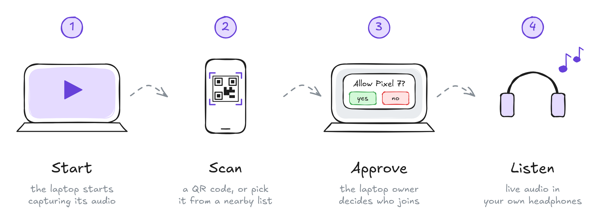

# eko

<p align="center">
  <a href="https://eko.allpyq.in/"></a>
</p>

<p align="center">
  <a href="https://github.com/Noelithub77/eko/releases/latest"></a>
  <a href="LICENSE"></a>
  <a href="https://github.com/Noelithub77/eko/actions/workflows/release.yml"></a>
  <a href="https://eko.allpyq.in/"></a>
  <a href="https://github.com/Noelithub77/eko/stargazers"></a>
</p>

Your computer’s audio, echoed to every phone nearby over Wi-Fi. Watch together on one screen while everyone listens on their own headphones. **No accounts, no cables, and you approve every device.**

Built with **Rust + Tauri**, with native Android playback and a browser fallback for iPhones. The name is an echo; the mark is a sound and the same shape turned around.

## Download

<p align="center">
  <a href="https://github.com/Noelithub77/eko/releases/download/eko-v0.5.0/eko_0.5.0_x64-setup.exe"></a>
  <a href="https://github.com/Noelithub77/eko/releases/download/eko-v0.5.0/eko_0.5.0_amd64.AppImage"></a>
  <a href="https://github.com/Noelithub77/eko/releases/download/eko-v0.5.0/eko_0.5.0_aarch64.dmg"></a>
  <a href="https://github.com/Noelithub77/eko/releases/download/eko-v0.5.0/eko-0.5.0-android-aarch64.apk"></a>
</p>

Windows: run the installer. Linux: make the AppImage executable, then open it. Android 8+: install the APK on your phone. On iPhone, scan the desktop’s QR code with the camera and open the browser client in Safari. [macOS beta](docs/macos-beta.md): Apple Silicon, macOS 13+. Open the DMG and drag eko to Applications.

[Website and interactive walkthrough](https://eko.allpyq.in/) · [All releases](https://github.com/Noelithub77/eko/releases) · [The story behind eko](https://medium.com/@noelmcv7/eko-share-audio-683aff638157)

> Early development: Linux is experimental, and latency and device compatibility are still being tested. There is no fixed latency guarantee.

## Start. Scan. Approve. Listen.

[](https://eko.allpyq.in/#how)

1. **Start** eko on your computer and play your audio.
2. **Scan** its QR code with eko on Android, or choose a nearby host. Keep both devices on the same local network for local listening.
3. **Approve** the phone on the desktop. Scanning a code never grants access by itself.
4. **Listen** through the phone’s headphones. Repeat for the other listeners.

## One sound, shared your way

- **Bring the headphones you already own.** Each phone receives the audio and plays through its own output; no shared Bluetooth broadcast hardware is required.
- **The desktop decides.** Approve or deny requests, control sharing for each device, disconnect listeners, or stop the stream.
- **Android first.** Native receive and playback, with Media3 media controls. Play and pause affect only that phone; resuming returns to the live stream.
- **A browser when you need one.** iPhones and browsers join through the hosted `/client` page. Android’s in-app scanner stays on the native receiver path.
- **Local when possible.** Android LAN discovery and native local listening can work without internet. The hosted browser path needs internet for signaling and short-lived TURN credentials.
- **Encrypted media.** WebRTC prefers a direct connection. When direct browser media is blocked, Cloudflare TURN relays encrypted audio to approved receivers.

<details>
<summary>How the pieces fit</summary>

```text
Desktop · Rust + Tauri
  System audio → capture → WebRTC → approved listeners
  QR pairing · LAN discovery · approval · session controls
                           |
                           +→ Android: native receiver + media controls
                           +→ iPhone / browser: hosted WebRTC client
```

Rust owns capture, signaling, discovery, approval, sessions, and media transport. React owns the screens. The hosted service exchanges signaling messages and supplies temporary TURN credentials; the desktop remains the authority for device access.

Only pair devices you trust and keep pairing links private. See the [privacy policy](docs/Privacy_Policy.md) and [security policy](.github/SECURITY.md).

</details>

## Build and contribute

The Chrome extension shares tab audio with approved listeners and reuses the
desktop app’s React components. Build its complete unpacked folder and Web Store
ZIP with `pnpm ops extension:package`. See [extension setup, audit and publishing](docs/chrome-extension.md).

Install Node.js, pnpm, Rust, and the platform dependencies in the [setup guide](.github/SETUP.md), then:

```powershell
git clone https://github.com/Noelithub77/eko.git
cd eko
pnpm install
pnpm dev:desktop
```

For Android development on Windows, install Android Studio, the SDK, and the NDK, then run `pnpm dev:android`. Keep the Tauri development terminal running while using Android Studio. [Linux diagnostics](docs/linux-operator.md) cover desktop audio and runtime investigation.

<details>
<summary>Previews and checks</summary>

UI-only previews do not capture or stream native audio:

```powershell
pnpm dev:web:desktop
pnpm dev:web:mobile
pnpm dev:web:client
```

Run checks for the layer you changed:

```powershell
pnpm test:types
pnpm lint
pnpm test:core
cd rust
cargo check
```

See the [setup guide](.github/SETUP.md) for Android and device verification.

</details>

The landing page and browser receiver share one Vite build and Cloudflare Worker:

```powershell
pnpm dev:web:site
# http://localhost:4040/
pnpm ops --help
```

Use a fork and open a pull request back to this repository. See [contributing](.github/CONTRIBUTING.md) and the [roadmap](.github/TODO.md).

[Changelog](.github/CHANGELOG.md) · [Report a bug](https://github.com/Noelithub77/eko/issues/new?template=bug_report.yml) · [Suggest a feature](https://github.com/Noelithub77/eko/issues/new?template=feature_request.yml) · [Support](.github/SUPPORT.md) · [Code of conduct](.github/CODE_OF_CONDUCT.md)

## License

eko is licensed under **GNU AGPL v3 or later**, [`AGPL-3.0-or-later`](LICENSE). Forks and modifications must retain the license terms, including the applicable corresponding-source requirements. Fonts and dependencies retain their own licenses and attribution.
